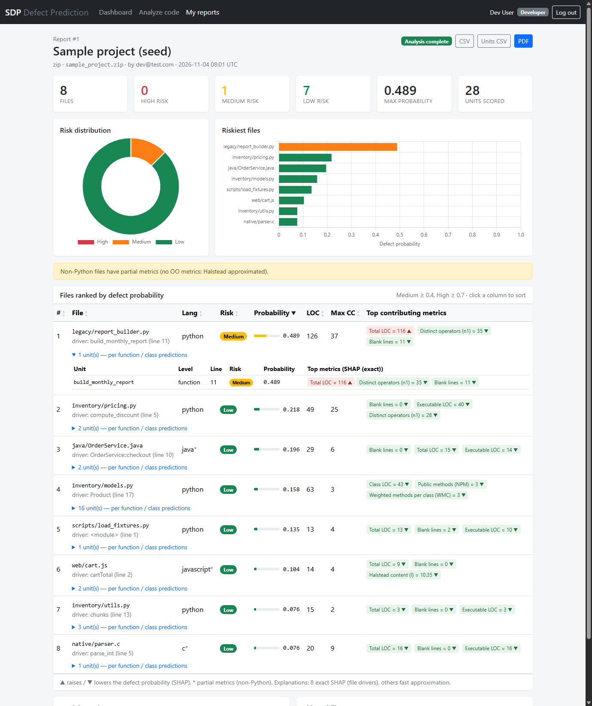
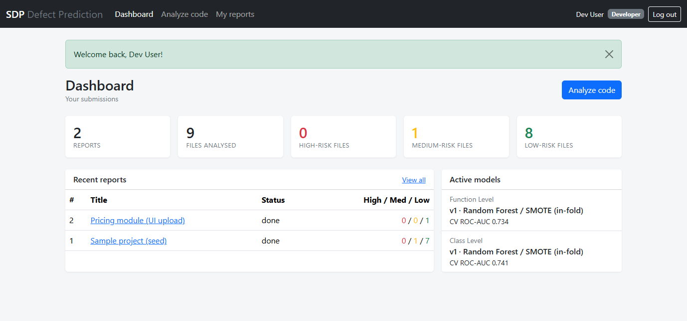

# Software Defect Prediction System

A web application that predicts which source files are most likely to contain defects.
Submit code as a **single file, a ZIP archive, or a public Git URL**; the system extracts
static code metrics (McCabe, Halstead, LOC, CK object-oriented metrics), scores every
function and class with machine-learning models trained on public defect datasets, and
produces a ranked, explained report (HTML, CSV, PDF).



| | |
|---|---|
| **Stack** | Python 3.11 · Flask (Jinja, server-rendered) · scikit-learn · imbalanced-learn · SHAP · SQLite / SQLAlchemy · radon · lizard · GitPython · ReportLab · Bootstrap 5 · Chart.js · pytest · Selenium |
| **Data** | NASA MDP (cleaned D'', function level) and PROMISE CK metrics (Jureczko & Madeyski, class level) |
| **Models** | Random Forest, Logistic Regression and MLP × {SMOTE, class weights}; best (RF + SMOTE) ships as v1 |
| **Roles** | Developer (submit, own reports) · QA Engineer (all reports, compare, export) · Admin (users, models, retraining, logs) |

---

## Contents
1. [Quick start](#quick-start)
2. [Using the app](#using-the-app)
3. [Command-line tools](#command-line-tools)
4. [How it works](#how-it-works)
5. [Model results](#model-results)
6. [Configuration](#configuration)
7. [Testing](#testing)
8. [Project structure](#project-structure)
9. [Security notes](#security-notes)
10. [Limitations](#limitations)
11. [Troubleshooting](#troubleshooting)
12. [Docker (optional, untested)](#docker-optional-untested)
13. [Data sources & citations](#data-sources--citations)

---

## Quick start

Requirements: **Python 3.11** (exactly 3.11: the trained models and pinned ML libraries are built for it),
and Google Chrome for the Selenium tests. Git is optional.

**Get the code:** either
`git clone https://github.com/Debdeeptax/defect-predictor.git`, or download the ZIP
([direct link](https://github.com/Debdeeptax/defect-predictor/archive/refs/heads/master.zip), or
green **Code** button → **Download ZIP**) and unzip it. A beginner, step-by-step version of these
instructions is in [`docs/Installation_Guide.pdf`](docs/Installation_Guide.pdf). It was written
while this repository was private, so **skip its Step 5**: no GitHub account or invitation is needed now.
For Selenium testing (setup, running the 70 browser tests, writing new ones, exam preparation), follow
[`docs/Selenium_Testing_Guide.pdf`](docs/Selenium_Testing_Guide.pdf).

**Windows (PowerShell)**
```powershell
cd defect-predictor          # the cloned folder (a downloaded ZIP unzips to defect-predictor-master)
py -3.11 -m venv .venv
.\.venv\Scripts\python.exe -m pip install --upgrade pip
.\.venv\Scripts\python.exe -m pip install -r requirements.txt
copy .env.example .env                      # then set SECRET_KEY
.\.venv\Scripts\python.exe scripts\reset_db.py   # tables + demo users + sample report
.\.venv\Scripts\python.exe run.py               # http://127.0.0.1:5000
```

**macOS / Linux**
```bash
python3.11 -m venv .venv && . .venv/bin/activate
pip install --upgrade pip
pip install -r requirements.txt
cp .env.example .env
python scripts/reset_db.py
python run.py
```

The trained models (`models/*_v1_*.joblib`) and the datasets (`data/raw/`) are included, so
nothing needs to be trained or downloaded to run the app. `GET /health` returns
`{"status": "ok", ...}` once the database and the function-level model are available.

### Demo accounts (created by `scripts/reset_db.py` / `scripts/seed.py`)

| Email | Password | Role |
|---|---|---|
| `dev@test.com` | `Test@1234` | Developer |
| `qa@test.com` | `Test@1234` | QA Engineer |
| `admin@test.com` | `Test@1234` | Admin |

Report **#1 "Sample project (seed)"** belongs to `dev@test.com`. Upload
`data/samples/sample_project.zip` to try an analysis yourself.

---

## Using the app

| Page | URL | Who | What |
|---|---|---|---|
| Login / Register | `/login`, `/register` | everyone | self-registration creates a **Developer**; admins grant other roles |
| Dashboard | `/dashboard` | all roles | totals by risk, recent reports, active model versions |
| Analyze code | `/upload` | Developer, Admin | source file, `.zip` (≤ 20 MB) or public HTTPS Git URL (GitHub / GitLab / Bitbucket) |
| Reports | `/reports` | all (Developers see their own) | sortable list, filter by risk |
| Report | `/reports/<id>` | owner, QA, Admin | summary cards, risk charts, ranked file table, per-unit drill-down, **CSV / units CSV / PDF** export |
| Compare runs | `/reports/compare` | QA, Admin | per-file Δ probability and risk changes between two reports |
| Users | `/admin/users` | Admin | change roles, activate / deactivate accounts |
| Models | `/admin/models` | Admin | model versions per level, **activate** a version, **retrain** (built-in data or uploaded CSV, quick 3×1 or standard 5×5 CV) |
| Logs | `/admin/logs` | Admin | audit trail (logins, uploads, exports, role changes, retraining) + application log tail |
| Health | `/health` | public | JSON status for monitoring |

**Reading a report.** Each function/class gets a defect probability; a file's probability is
that of its riskiest unit (its *driver*). Risk labels: **Low < 0.4 ≤ Medium < 0.7 ≤ High**
(configurable). "Top contributing metrics" are SHAP values: ▲ pushes the probability up,
▼ pulls it down. Each file's driver is explained with exact Tree SHAP; other units use a fast
approximation (labelled in the tooltip).



---

## Command-line tools

All scripts run from the project root with the virtual-env Python.

| Command | Purpose |
|---|---|
| `python run.py` | start the web app (`HOST`/`PORT` from `.env`) |
| `python scripts/reset_db.py` | drop + recreate tables, seed demo users and the sample report (repeatable state for Selenium) |
| `python scripts/seed.py [--reset] [--no-report]` | idempotent seeding |
| `flask --app run init-db \| seed \| reset-db [--no-seed]` | same via the Flask CLI |
| `python scripts/download_datasets.py [--force]` | re-download NASA MDP / PROMISE into `data/raw/` (sha256 manifest) |
| `python scripts/train.py [--level function\|class\|all] [--folds 5 --repeats 5] [--quick] [--csv file.csv] [--no-activate]` | train + evaluate all candidates, save and activate the best, write `docs/results/` |
| `python scripts/extract_metrics.py <dir> [--csv prefix]` | print / save the extracted metrics |
| `python scripts/predict.py <dir\|file\|zip> [--git URL] [--csv f] [--units-csv f] [--pdf f] [--json f]` | full analysis without the web UI |
| `python scripts/make_sample_zip.py` | rebuild `data/samples/sample_project.zip` |

Full training (`scripts/train.py`, 5×5 CV, both levels) takes ~17 min on a 4-core laptop.

---

## How it works

```
routes (Flask blueprints) ──► services ──► metrics / ml modules ──► DB (SQLite via SQLAlchemy)
```

1. **CodeRepository** (`app/services/code_repository.py`) unpacks the submission into an
   isolated workspace: secure filenames, zip-slip / symlink / zip-bomb / encrypted-zip
   rejection, HTTPS-only Git with a host allow-list, no credentials, hard clone timeout,
   size caps. Code is only *parsed*, never executed. The workspace is deleted afterwards.
2. **MetricExtractor** (`app/metrics/`) walks the tree:
   * **Python (full)**: radon McCabe complexity + maintainability index; `tokenize`-based
     line classes and **token-level Halstead** (the McCabe IQ / NASA convention; radon's
     operator-only Halstead is on a different scale); CK metrics in **ckjm conventions**
     (WMC, DIT, NOC, CBO, RFC, LCOM, LCOM3, Ce, NPM; class LOC/AMC from compiled bytecode
     instruction counts, mirroring ckjm's bytecode-based LOC).
   * **Java, C/C++, C#, JS/TS, Go, Kotlin, Swift, PHP, Scala, Rust (partial)**: lizard CC/LOC
     + token Halstead; no OO metrics.
3. **PredictionEngine** (`app/services/prediction_engine.py`) scores functions with the
   function-level model and classes with the class-level model, aggregates per file (max),
   labels risk, and explains with SHAP (`app/ml/explain.py`).
4. **ReportService** renders CSV / PDF and compares runs; the **Report** row stores the
   JSON payload plus a summary for fast listing.

Required classes → code: `User` (`app/models/user.py`), `CodeRepository` (service +
`Submission` row), `MetricExtractor`, `DataPreprocessor` (`app/ml/data_preprocessor.py`),
`MLModel` (`app/ml/ml_model.py`), `PredictionEngine`, `Report` (`app/models/report.py` +
`report_service.py`). Design decisions are recorded in [docs/PLAN.md](docs/PLAN.md).

**Model versioning.** `models/registry.json` lists every version per level and the active
one; it is shared by the CLI and the web app. Files: `models/<level>_v<N>_<algo>_<imbalance>_<timestamp>.joblib`
(pipeline + metadata: features, CV metrics, significance tests, feature importance, SHAP
background sample). Only the shipped v1 models are tracked by git.

---

## Model results

Repeated stratified 5-fold × 5 CV on the cleaned, pooled datasets (mean ± std, threshold 0.5).
Full tables, significance tests, per-project results and plots: [docs/results/RESULTS.md](docs/results/RESULTS.md).

| Level | Rows | Selected | ROC-AUC | F1 | Recall | Cross-project AUC (LOPO) |
|---|---|---|---|---|---|---|
| Function (NASA MDP, 11 projects) | 15,184 | RF + SMOTE | **0.734 ± 0.009** | 0.408 | 0.376 | 0.695 |
| Class (PROMISE CK, 37 releases) | 8,466 | RF + SMOTE | **0.741 ± 0.009** | 0.564 | 0.550 | 0.678 |

* RF beats LR and MLP at both levels (Friedman p < 1e-16; Holm-corrected Wilcoxon, large
  Cliff's δ). At class level RF+SMOTE vs RF+class-weights is not significant.
* Data cleaning (documented in PLAN.md §2.1b): NASA PC2 skipped (no `LOC_BLANK`);
  conflicting-label duplicates removed at both levels; PROMISE releases > 75 % defective
  excluded (xalan-2.7, log4j-1.2, xerces-1.4.4, velocity-1.5).
* Size metrics dominate importance at both levels (total / class LOC), then coupling (Ce, NPM)
  and complexity, consistent with the defect-prediction literature.

---

## Configuration

Copy `.env.example` to `.env`. All settings have safe defaults except `SECRET_KEY`.

| Variable | Default | Meaning |
|---|---|---|
| `SECRET_KEY` | dev placeholder | **set a random value** (sessions, CSRF) |
| `HOST` / `PORT` | `127.0.0.1` / `5000` | bind address for `run.py` |
| `DATABASE_URL` | `sqlite:///instance/sdp.db` | SQLAlchemy URL (relative SQLite paths are resolved from the project root) |
| `UPLOAD_DIR`, `WORKSPACE_DIR`, `MODEL_DIR`, `LOG_DIR` | `instance/uploads`, `instance/workspaces`, `models`, `logs` | storage locations |
| `LOG_LEVEL` | `INFO` | rotating log `logs/app.log` (1 MB × 5) |
| `MAX_UPLOAD_MB` | `20` | max upload size |
| `MAX_REPO_MB` | `100` | max extracted ZIP / cloned repo size |
| `MAX_FILES_PER_ANALYSIS` | `2000` | larger repos are truncated with a warning |
| `GIT_CLONE_TIMEOUT_SEC` | `60` | hard timeout for `git clone` |
| `ALLOWED_GIT_HOSTS` | `github.com,gitlab.com,bitbucket.org` | Git host allow-list |
| `RISK_MEDIUM_THRESHOLD` / `RISK_HIGH_THRESHOLD` | `0.4` / `0.7` | risk label cut-offs |
| `EXACT_SHAP_BUDGET_SEC` | `15` | seconds of exact SHAP per analysis (file drivers, riskiest first) |

---

## Testing

```powershell
.\.venv\Scripts\python.exe -m pytest                       # everything (~1.5 min)
.\.venv\Scripts\python.exe -m pytest -m "not selenium"     # skip browser tests
.\.venv\Scripts\python.exe -m pytest -m "not network"      # skip tests that clone from GitHub
.\.venv\Scripts\python.exe -m pytest --cov=app --cov=config --cov-report=term-missing
```

| Suite | Folder | Covers |
|---|---|---|
| Unit | `tests/unit/` | features & Halstead formulas, preprocessing/cleaning, all model families, registry, statistics helpers, metric extraction (Python + lizard, CK conventions), explanations (tree / linear / importance), prediction engine invariants & determinism, ingestion security (zip-slip, bombs, symlinks, Git URL validation, hermetic `git clone` fakes), CSV/PDF/compare |
| Integration | `tests/integration/` | auth, role-access matrix, uploads & error messages, report visibility, exports, compare, admin (roles, deactivation, retrain from CSV, activation), CLI, error pages, CSRF, missing models, failure handling; **test-id audit** of 19 rendered pages; **locator-doc sync** |
| Selenium | `tests/selenium/` | POM skeleton + sample tests: login, upload → prediction, role access |

Network tests skip automatically when GitHub is unreachable.

### Selenium tests

```powershell
.\.venv\Scripts\python.exe -m pytest tests/selenium -v          # headless Chrome, isolated seeded app on a free port
$env:SDP_HEADLESS="0"; .\.venv\Scripts\python.exe -m pytest tests/selenium   # watch the browser
# against a running server (reset it first for repeatable data):
.\.venv\Scripts\python.exe scripts/reset_db.py; $env:SDP_BASE_URL="http://127.0.0.1:5000"; .\.venv\Scripts\python.exe -m pytest tests/selenium
```

- Locators: [docs/selenium-locators.md](docs/selenium-locators.md) (`data-testid` + unique `id` on every interactive element; dynamic ids such as `risk-badge-<path-key>`).
- Page Objects: `tests/selenium/pages/` (`BasePage`, `LoginPage`, `UploadPage`, `ReportPage`).
- Sync markers instead of sleeps: `status-done` / `status-failed`, `loading-indicator`, charts set `data-rendered="true"`.
- Chrome is driven via Selenium Manager (no manual chromedriver). Without Chrome the tests are skipped.
- Failing Selenium tests save a screenshot + HTML to `tests/selenium/artifacts/`.

---

## Project structure

```
defect-predictor/
├── run.py · config.py · requirements.txt · requirements-lock.txt · .env.example · Dockerfile
├── app/
│   ├── __init__.py          create_app(), logging, error handlers, CLI
│   ├── models/              User, Submission, Report, AuditEvent, TrainingJob
│   ├── routes/              auth, main, upload, reports, admin, health
│   ├── services/            code_repository, analysis, prediction_engine, report, training, user, audit
│   ├── metrics/             metric_extractor, python_metrics, oo_metrics, halstead, lizard_metrics, languages
│   ├── ml/                  features, data_preprocessor, ml_model, registry, trainer, explain
│   ├── templates/ · static/ (Bootstrap 5.3.3 + Chart.js 4.4.4 vendored)
├── data/raw/                NASA MDP + PROMISE CSVs, manifest.json (sha256), SOURCES.md
├── data/samples/            sample_project/ (+ .zip), edge_cases/
├── models/                  v1 models + registry.json
├── scripts/                 download_datasets, train, extract_metrics, predict, seed, reset_db, make_sample_zip
├── docs/                    PLAN.md, results/, selenium-locators.md, sample_report/, screenshots/
└── tests/                   unit/, integration/, selenium/ (conftest, pages/, tests/), helpers.py
```

---

## Security notes

* Submitted code is never executed (parsed with `ast`/`tokenize`/lizard; Python is `compile()`d for bytecode counts, which does not run it).
* Uploads: size limit, secure filenames, ZIP path-traversal / absolute-path / symlink / encrypted / zip-bomb checks.
* Git: HTTPS only, host allow-list, no credentials in URLs, no prompts, `protocol.file.allow=never`, timeout, size cap; `.git` is removed after cloning.
* Auth: hashed passwords (Werkzeug), CSRF on all forms, role checks on every route, open-redirect-safe `next`, admins cannot demote or deactivate themselves; inactive accounts cannot log in.
* Admins cannot upload `.joblib` files (pickle executes code on load); they upload training CSVs instead.
* The demo accounts have a published password; reset or remove them on any shared deployment.
* `run.py` uses Flask's built-in server for local use. Use a WSGI server (e.g. gunicorn, waitress) for anything else.

---

## Limitations

* **Domain shift.** Models are trained on NASA (C/Java functions) and PROMISE (Java classes) and applied to arbitrary code, Python included. Treat scores as a *relative ranking* within a submission, not calibrated probabilities. Typical sign: "0 blank lines" lowers risk for compact Python functions.
* Non-Python files have partial metrics (no OO metrics; Halstead approximated from tokens).
* CK metrics for Python are approximations of ckjm's Java definitions (e.g. DIT treats unknown external bases as depth 1; Ce counts imported / capitalised names).
* NASA `ESSENTIAL_COMPLEXITY` / `DESIGN_COMPLEXITY` and several CK extensions (`ca`, `dam`, `moa`, `mfa`, `cam`, `ic`, `cbm`) are not used because they cannot be extracted reliably.
* At threshold 0.5 recall is modest (0.38 function level); the Medium band (≥ 0.4) is the practical triage threshold.
* Repeated-CV folds overlap, so significance p-values are optimistic; effect sizes are reported alongside.
* Analysis is synchronous (fine for typical repos; very large repositories may approach request timeouts).

---

## Troubleshooting

| Symptom | Fix |
|---|---|
| `pip install` fails with a read timeout or is very slow | slow connection to PyPI: `python -m pip install --timeout 120 --retries 10 -r requirements.txt` (re-running reuses already downloaded wheels) |
| `ModelNotAvailableError` / `/health` says `degraded` | ensure `models/registry.json` and the `.joblib` files exist, or run `python scripts/train.py` |
| Model fails to load after upgrading packages | the artifacts are pickled with scikit-learn 1.7.2; keep the pinned versions or retrain |
| Port 5000 in use | set `PORT=5001` in `.env` |
| Selenium tests are skipped | install Google Chrome; Selenium Manager fetches the matching driver (needs internet once) |
| Want a clean slate | `python scripts/reset_db.py` |

---

## Docker (optional, untested)

A `Dockerfile` is provided (Python 3.11 slim + git + gunicorn). It was written without a
Docker installation available, so **it has not been built or tested**.

```bash
docker build -t sdp .
docker run -p 5000:5000 -e SECRET_KEY=change-me -e SEED_DEMO_DATA=1 sdp
```

---

## Data sources & citations

* M. Shepperd, Q. Song, Z. Sun, C. Mair. *Data Quality: Some Comments on the NASA Software Defect Datasets.* IEEE TSE 39(9), 2013 (cleaned D'' version; mirror: github.com/klainfo/NASADefectDataset).
* M. Jureczko, L. Madeyski. *Towards identifying software project clusters with regard to defect prediction.* PROMISE 2010 (mirror: github.com/feiwww/PROMISE-backup).
* S. Chidamber, C. Kemerer. *A Metrics Suite for Object Oriented Design.* IEEE TSE 20(6), 1994.
* T. McCabe. *A Complexity Measure.* IEEE TSE 2(4), 1976. · M. Halstead. *Elements of Software Science.* 1977.
* S. Lundberg, S.-I. Lee. *A Unified Approach to Interpreting Model Predictions.* NeurIPS 2017 (SHAP).

Exact file checksums: `data/raw/manifest.json`; details: `data/raw/SOURCES.md`.
