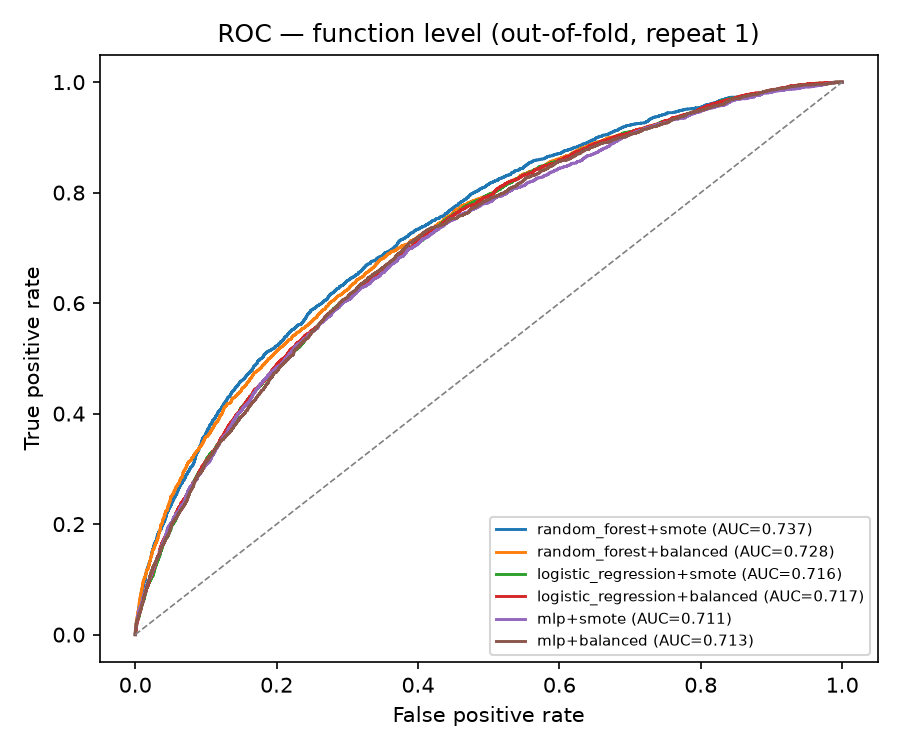
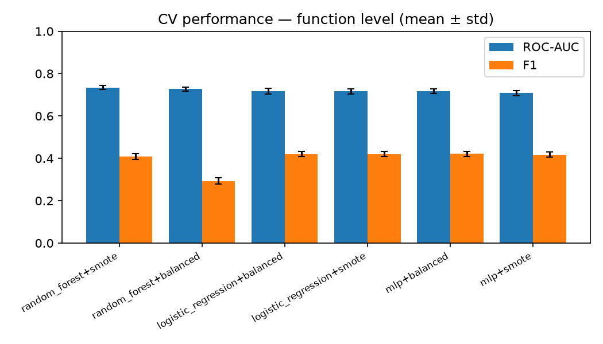
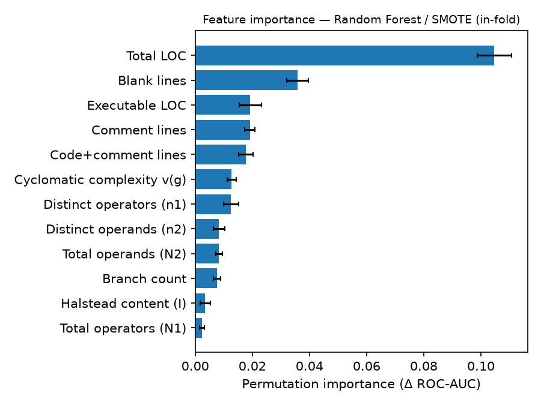
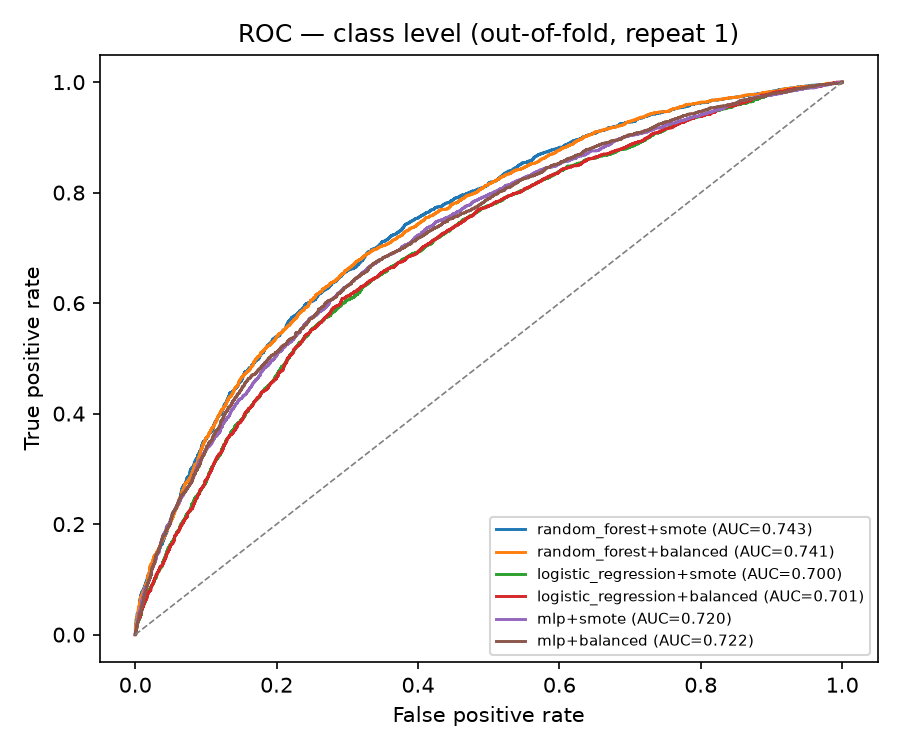
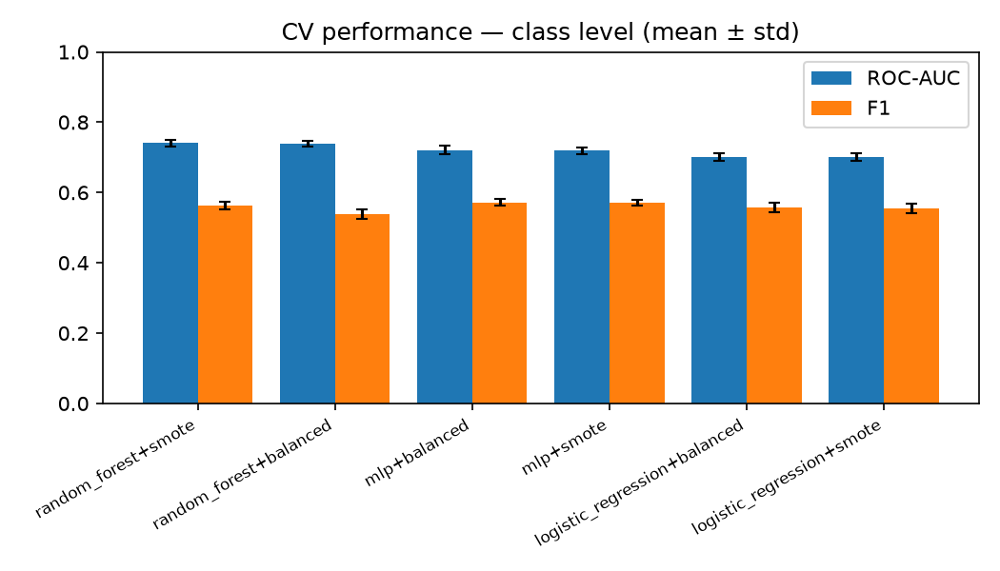
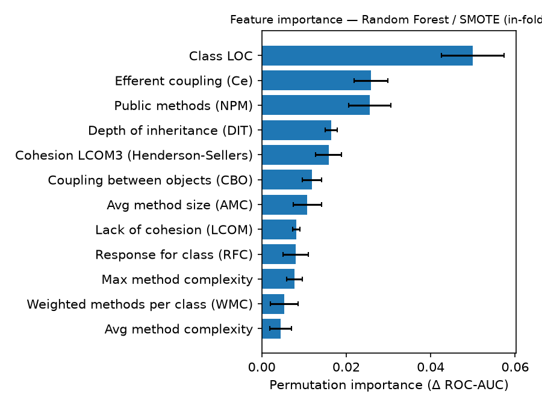

# Model training results

Generated by `scripts/train.py`. Metrics are mean ± std over repeated stratified k-fold CV (threshold 0.5 for label metrics).

## Function-level model

- Dataset: `nasa_mdp_d2` — 15184 rows after cleaning (16425 raw; dropped 0 NA, 132 invalid, 1087 exact duplicates, 22 conflicting-label duplicates)
- Skipped file `PC2.csv`: Missing NASA MDP columns: ['LOC_BLANK']
- Defective rate: 19.1%; projects: 11
- CV: 5 folds × 5 repeats
- **Selected: Random Forest / SMOTE (in-fold)** → `models/function_v1_rf_smote_20261104073305.joblib`

| Model | accuracy | precision | recall | f1 | roc_auc | pr_auc | mcc |
|---|---|---|---|---|---|---|---|
| **random_forest+smote** | 0.793 ± 0.005 | 0.448 ± 0.016 | 0.376 ± 0.017 | 0.408 ± 0.013 | 0.734 ± 0.009 | 0.416 ± 0.015 | 0.285 ± 0.016 |
| random_forest+balanced | 0.816 ± 0.004 | 0.548 ± 0.028 | 0.200 ± 0.013 | 0.293 ± 0.015 | 0.727 ± 0.009 | 0.415 ± 0.016 | 0.249 ± 0.017 |
| logistic_regression+balanced | 0.662 ± 0.007 | 0.312 ± 0.009 | 0.644 ± 0.023 | 0.421 ± 0.012 | 0.717 ± 0.013 | 0.380 ± 0.014 | 0.250 ± 0.018 |
| logistic_regression+smote | 0.661 ± 0.007 | 0.312 ± 0.009 | 0.646 ± 0.023 | 0.421 ± 0.012 | 0.717 ± 0.013 | 0.377 ± 0.014 | 0.250 ± 0.019 |
| mlp+balanced | 0.664 ± 0.015 | 0.314 ± 0.011 | 0.641 ± 0.030 | 0.421 ± 0.012 | 0.716 ± 0.011 | 0.385 ± 0.016 | 0.250 ± 0.017 |
| mlp+smote | 0.670 ± 0.013 | 0.315 ± 0.011 | 0.618 ± 0.021 | 0.417 ± 0.012 | 0.709 ± 0.012 | 0.381 ± 0.017 | 0.244 ± 0.018 |

**Significance (roc_auc, 25 paired folds)**

- Friedman χ² = 84.77, p = 8.41e-17

| Best vs | p (Holm) | Cliff's δ | Effect | Significant |
|---|---|---|---|---|
| logistic_regression+balanced | 2.98e-07 | +0.725 | large | yes |
| logistic_regression+smote | 2.98e-07 | +0.750 | large | yes |
| mlp+smote | 2.98e-07 | +0.923 | large | yes |
| mlp+balanced | 3.58e-07 | +0.795 | large | yes |
| random_forest+balanced | 3.58e-07 | +0.386 | medium | yes |

_Repeated-CV folds overlap, so p-values are optimistic; read alongside effect sizes._

**Cross-project validation (leave-one-project-out, selected model)**

| Held-out project | n | defect rate | ROC-AUC | F1 | Recall |
|---|---|---|---|---|---|
| CM1 | 327 | 12.8% | 0.642 | 0.271 | 0.452 |
| JM1 | 7711 | 20.9% | 0.648 | 0.348 | 0.348 |
| KC1 | 1133 | 25.9% | 0.615 | 0.238 | 0.174 |
| KC3 | 192 | 18.8% | 0.696 | 0.339 | 0.278 |
| MC1 | 1262 | 2.7% | 0.740 | 0.167 | 0.412 |
| MC2 | 124 | 35.5% | 0.576 | 0.388 | 0.295 |
| MW1 | 249 | 10.0% | 0.745 | 0.426 | 0.400 |
| PC1 | 679 | 8.1% | 0.870 | 0.443 | 0.491 |
| PC3 | 780 | 16.7% | 0.699 | 0.249 | 0.185 |
| PC4 | 1221 | 14.4% | 0.728 | 0.188 | 0.136 |
| PC5 | 1506 | 29.9% | 0.684 | 0.416 | 0.344 |
| **mean** | | | **0.695** | 0.316 | 0.320 |

**Top features (permutation importance, Δ ROC-AUC on 25 % hold-out)**

1. Total LOC — 0.1047
2. Blank lines — 0.0358
3. Executable LOC — 0.0193
4. Comment lines — 0.0192
5. Code+comment lines — 0.0177
6. Cyclomatic complexity v(g) — 0.0128
7. Distinct operators (n1) — 0.0126
8. Distinct operands (n2) — 0.0083

  

## Class-level model

- Dataset: `promise_ck` — 8466 rows after cleaning (15775 raw; dropped 0 NA, 129 invalid, 3935 exact duplicates, 2282 conflicting-label duplicates)
- Excluded release `xalan-2.7` (433 rows, 99.8% defective — implausible labelling)
- Excluded release `log4j-1.2` (139 rows, 94.2% defective — implausible labelling)
- Excluded release `xerces-1.4.4` (261 rows, 90.0% defective — implausible labelling)
- Excluded release `velocity-1.5` (130 rows, 77.7% defective — implausible labelling)
- Defective rate: 33.7%; projects: 37
- CV: 5 folds × 5 repeats
- **Selected: Random Forest / SMOTE (in-fold)** → `models/class_v1_rf_smote_20261104073649.joblib`

| Model | accuracy | precision | recall | f1 | roc_auc | pr_auc | mcc |
|---|---|---|---|---|---|---|---|
| **random_forest+smote** | 0.714 ± 0.007 | 0.579 ± 0.013 | 0.550 ± 0.018 | 0.564 ± 0.011 | 0.741 ± 0.009 | 0.588 ± 0.014 | 0.352 ± 0.015 |
| random_forest+balanced | 0.718 ± 0.007 | 0.602 ± 0.015 | 0.486 ± 0.018 | 0.538 ± 0.013 | 0.740 ± 0.008 | 0.587 ± 0.013 | 0.343 ± 0.016 |
| mlp+balanced | 0.669 ± 0.010 | 0.507 ± 0.012 | 0.658 ± 0.028 | 0.572 ± 0.010 | 0.721 ± 0.011 | 0.561 ± 0.022 | 0.317 ± 0.016 |
| mlp+smote | 0.670 ± 0.012 | 0.509 ± 0.014 | 0.651 ± 0.025 | 0.571 ± 0.009 | 0.719 ± 0.010 | 0.558 ± 0.021 | 0.316 ± 0.015 |
| logistic_regression+balanced | 0.661 ± 0.009 | 0.497 ± 0.010 | 0.633 ± 0.024 | 0.557 ± 0.013 | 0.701 ± 0.011 | 0.529 ± 0.017 | 0.294 ± 0.019 |
| logistic_regression+smote | 0.660 ± 0.008 | 0.496 ± 0.010 | 0.632 ± 0.026 | 0.556 ± 0.014 | 0.700 ± 0.011 | 0.529 ± 0.017 | 0.293 ± 0.020 |

**Significance (roc_auc, 25 paired folds)**

- Friedman χ² = 107.40, p = 1.45e-21

| Best vs | p (Holm) | Cliff's δ | Effect | Significant |
|---|---|---|---|---|
| logistic_regression+balanced | 2.98e-07 | +0.990 | large | yes |
| logistic_regression+smote | 2.98e-07 | +0.990 | large | yes |
| mlp+smote | 8.94e-07 | +0.891 | large | yes |
| mlp+balanced | 1.67e-06 | +0.859 | large | yes |
| random_forest+balanced | 7.55e-02 | +0.120 | negligible | no |

_Repeated-CV folds overlap, so p-values are optimistic; read alongside effect sizes._

**Cross-project validation (leave-one-project-out, selected model)**

| Held-out project | n | defect rate | ROC-AUC | F1 | Recall |
|---|---|---|---|---|---|
| ant | 1419 | 23.2% | 0.735 | 0.495 | 0.669 |
| camel | 1647 | 23.7% | 0.599 | 0.336 | 0.345 |
| ivy | 616 | 18.8% | 0.711 | 0.407 | 0.534 |
| jedit | 1351 | 21.2% | 0.708 | 0.449 | 0.654 |
| log4j | 127 | 48.0% | 0.839 | 0.673 | 0.574 |
| lucene | 556 | 63.3% | 0.677 | 0.455 | 0.315 |
| poi | 585 | 66.8% | 0.721 | 0.643 | 0.524 |
| synapse | 476 | 30.3% | 0.616 | 0.414 | 0.368 |
| velocity | 263 | 60.5% | 0.635 | 0.413 | 0.283 |
| xalan | 1062 | 47.0% | 0.637 | 0.525 | 0.475 |
| xerces | 364 | 34.1% | 0.585 | 0.457 | 0.508 |
| **mean** | | | **0.678** | 0.479 | 0.477 |

**Top features (permutation importance, Δ ROC-AUC on 25 % hold-out)**

1. Class LOC — 0.0500
2. Efferent coupling (Ce) — 0.0259
3. Public methods (NPM) — 0.0256
4. Depth of inheritance (DIT) — 0.0164
5. Cohesion LCOM3 (Henderson-Sellers) — 0.0158
6. Coupling between objects (CBO) — 0.0119
7. Avg method size (AMC) — 0.0108
8. Lack of cohesion (LCOM) — 0.0081

  
